<p align="center">
  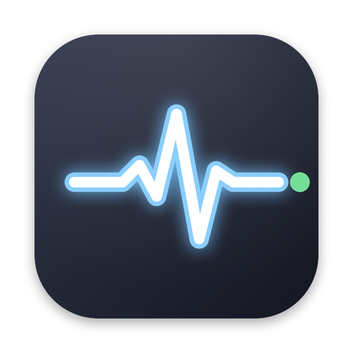
</p>

# Dotmeter

A check-up for your Mac. Dotmeter lives in the menu bar for the quick look and opens a window for the full picture: what is using the processor, graphics, memory, disk, network and power right now, how hot the Mac is running, what is plugged into every port, and what happened earlier today.

<p align="center">
  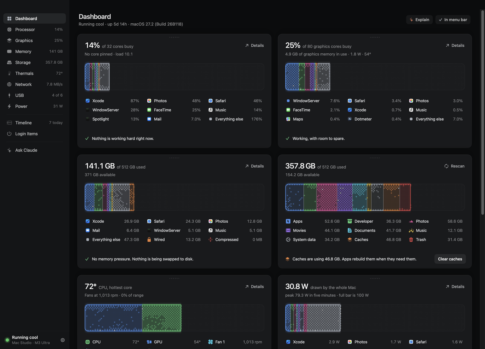
</p>

Every screenshot here uses made-up apps, addresses and devices. The app has a demo mode for each area, so nothing personal ends up in a picture.

## Features

### In the menu bar

Any area can sit in the menu bar as its own item, in any combination. Each item draws a small live graph and its figure, and opens a panel about that area when clicked. Click the item again to close it.

<p align="center">
  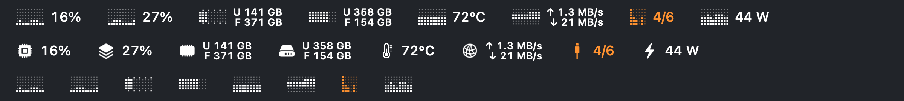
</p>

- Processor and Graphics show load. Memory and Storage show used over free. Thermals shows the hottest sensor in °C. Network shows upload over download. USB shows one column per port. Power shows watts.
- Three styles per item: graph and value, icon and value, graph only.
- An item changes colour when it needs attention: memory under pressure, the Mac running hot, the disk nearly full, the network offline, a USB connection running slower than it could.

<p align="center">
  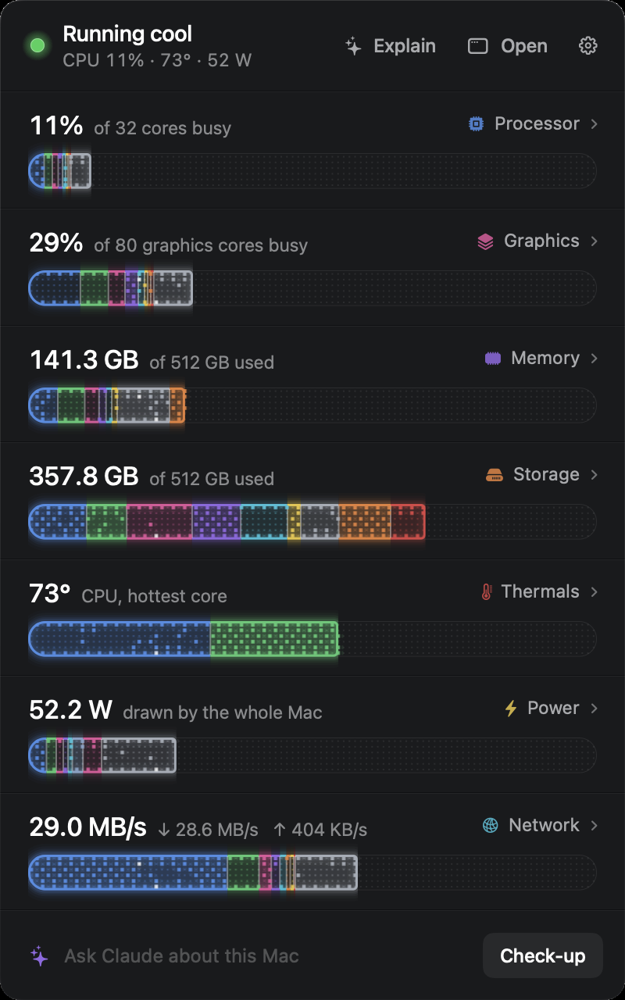
  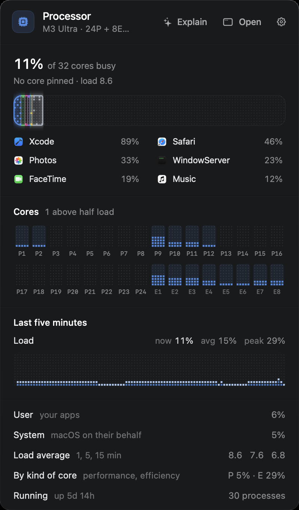
  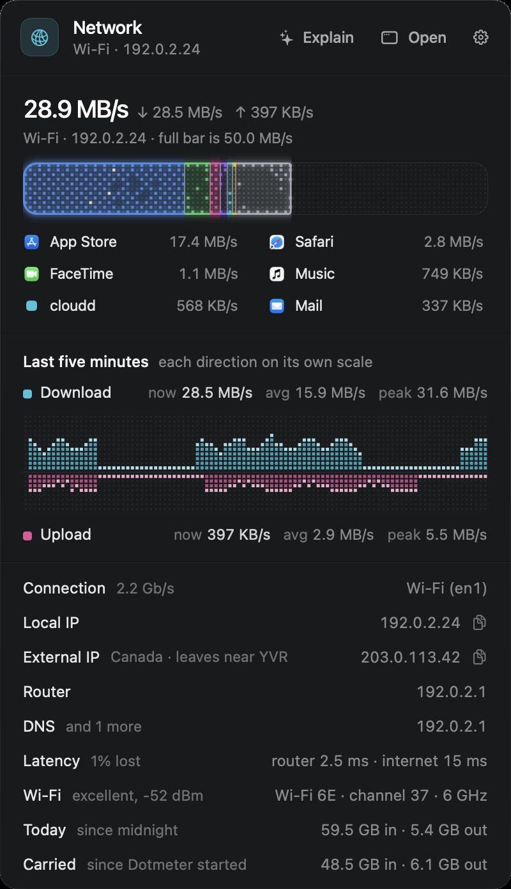
</p>

### Dashboard

One card per area. Drag a card onto another to move it, or right-click a card for Move to the Top, Up, Down and Bottom, so what matters to you is on top. The menu bar panel follows the same order.

### Processor, Graphics and Memory

Who is using each, as one bar split by app, with every core, five minutes of history, and a table you can expand to see an app's processes. An app that is working hard can be quit from its row.

<p align="center">
  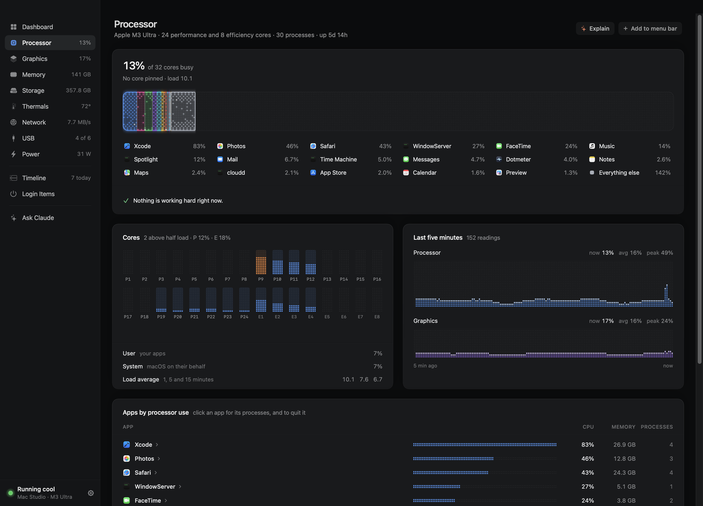
  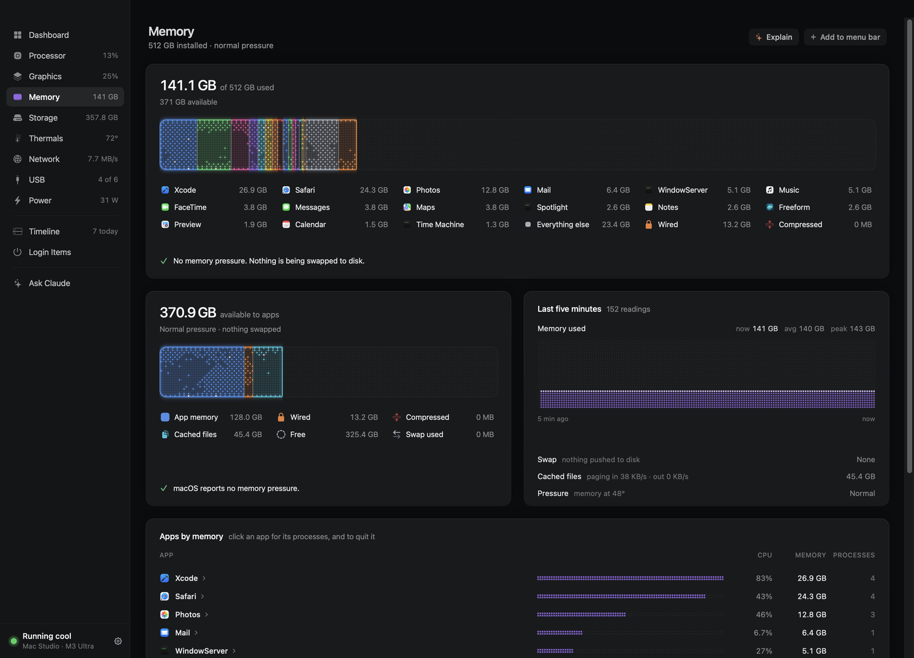
</p>

### Storage

Scan the disk to see what it is made of: apps, developer files, photos, movies, documents, music, system data, caches and the Trash. Shared storage is counted once, so the categories add up to what the disk reports.

- Clear caches or empty the Trash, or remove one item at a time.
- **Uninstall an app** with what it left behind: its settings, caches, support files and background items. The row tells you what will go before you confirm. A search finds any installed app, and you can drop an app onto the page.
- Apps owned by the system are removed by a small helper that macOS asks you to allow once.
- **Drive health**: how worn the internal drive is, from the drive's own record: the share of its rated life used, how much has been written and read since new, hours powered on, unsafe shutdowns, spare blocks and any warning it has raised.

<p align="center">
  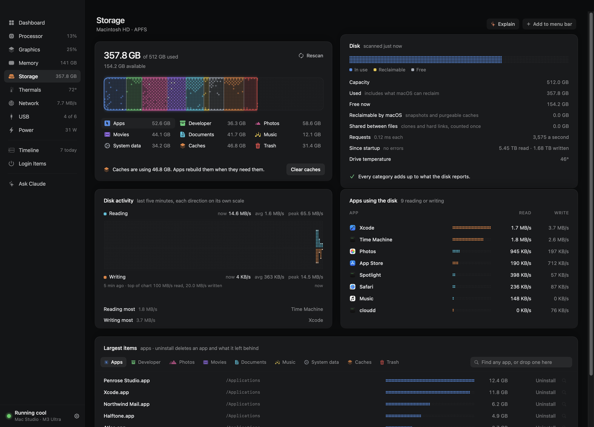
</p>
<p align="center">
  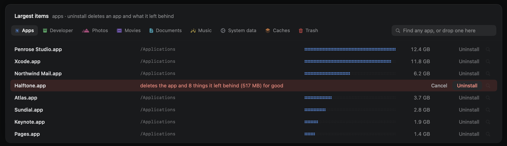
</p>

### Thermals and Power

Every temperature sensor and fan, with the hottest readings charted against load. Power shows what the whole Mac draws and which apps the energy goes to, with the cost over a day, a month or a year if you enter your price per kWh. On a laptop there is a Battery area as well.

Power also lists the accessories that report a battery level: keyboards, mice and trackpads, and headphones with their charging cases. A keyboard, mouse or trackpad that falls to 15% gets a note in the Timeline and can send a notification.

<p align="center">
  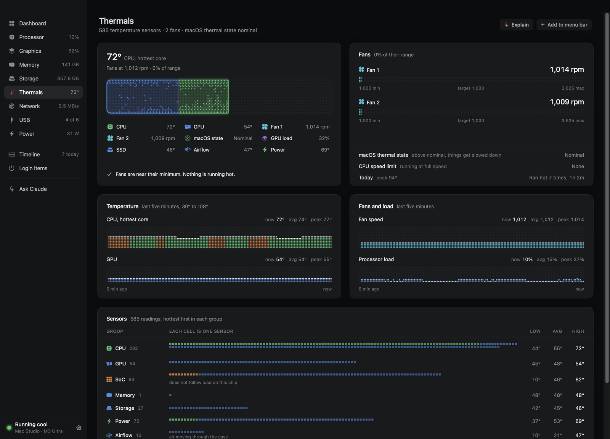
  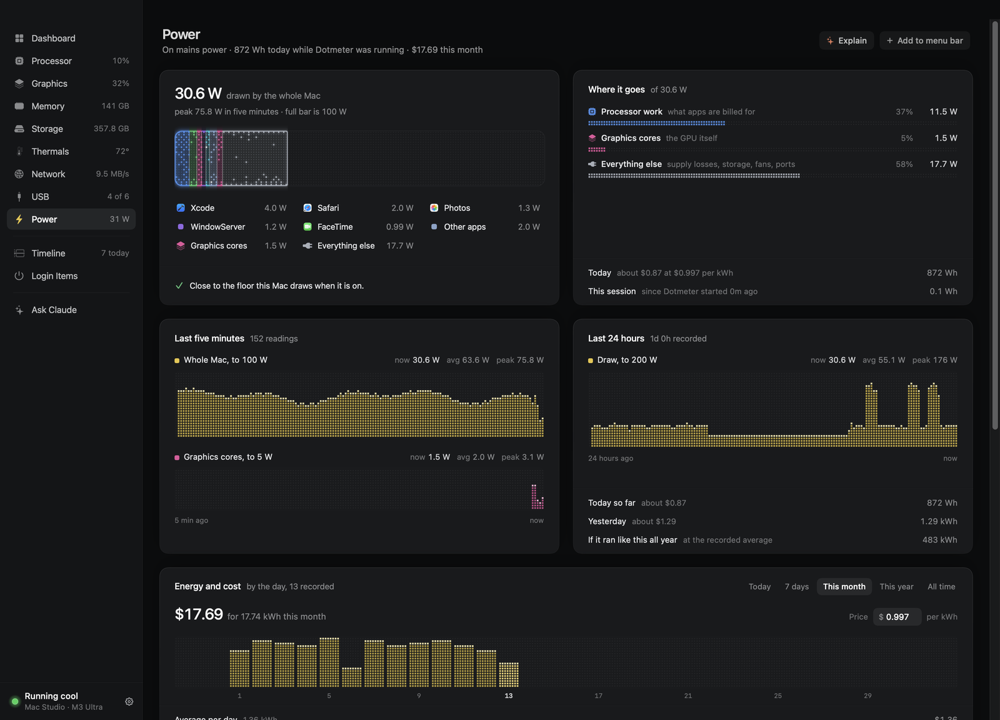
</p>

### Network

Traffic by app, the route from this Mac to the router and the internet, the Wi-Fi or wired link, latency and loss, and a speed test you start yourself.

- Local and external IP, each copied with one click, with the country your traffic leaves from.
- **Open ports**: which apps are waiting for connections, split into those other devices can reach and those that only answer to this Mac.

<p align="center">
  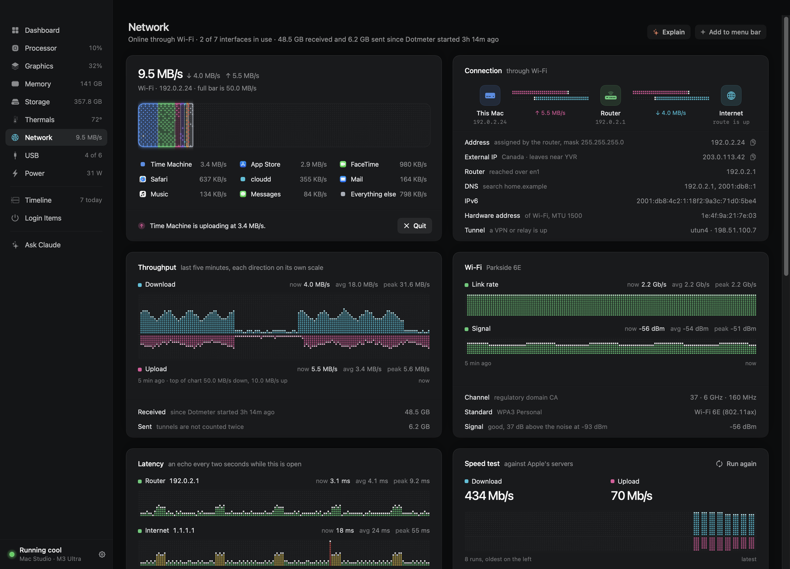
</p>
<p align="center">
  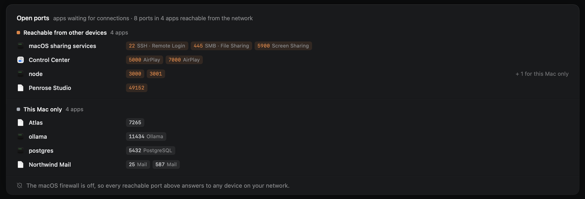
</p>

### USB

Every port and what is on it. For each connection Dotmeter works out what is setting the speed: the Mac's port, the cable or the device. It reads the chip in the cable's plug (speed, wattage, length, maker), shows Thunderbolt lanes, displays, chargers and the tree of devices behind a hub, and says so in plain words when a cable is holding a drive or a charger back.

<p align="center">
  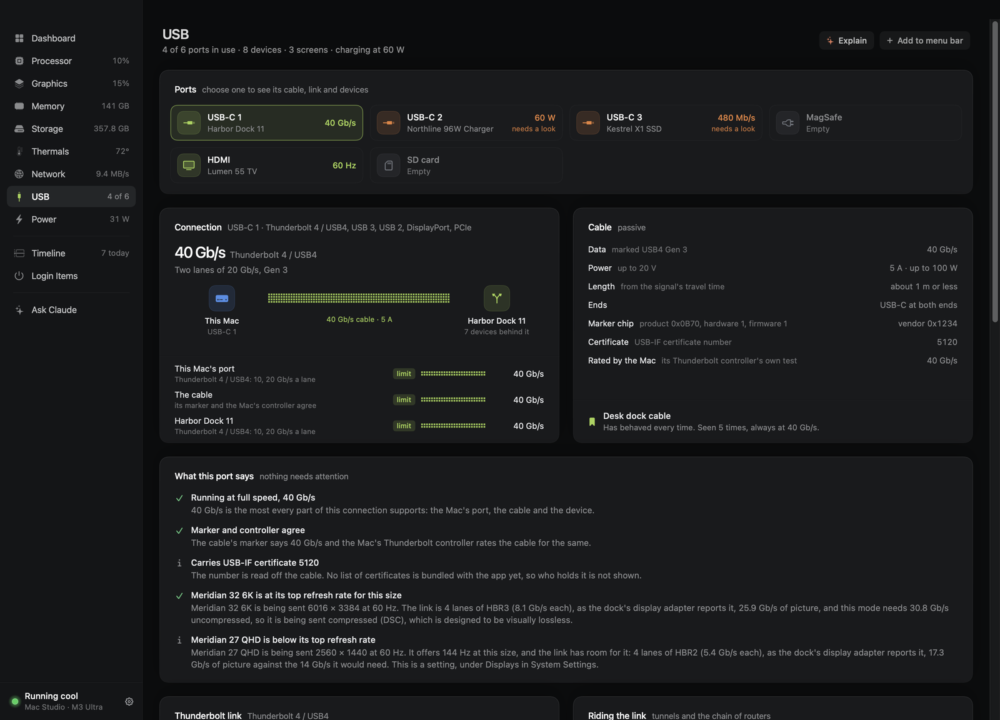
</p>

### Timeline

One line a minute is kept for a week: load, heat, fan speed, traffic and power. Events are marked on it, such as the Mac running hot, an app holding several cores, memory pressure, the disk filling up, the connection dropping, or a slow USB connection. Each event can also send a notification.

The Timeline also notes when an app uses the microphone, when the camera comes on, and when an app crashes, and the sidebar shows a quiet line while the microphone or camera is in use. Dotmeter reads only what macOS already publishes for this, so it never asks for microphone or camera permission and never opens either.

<p align="center">
  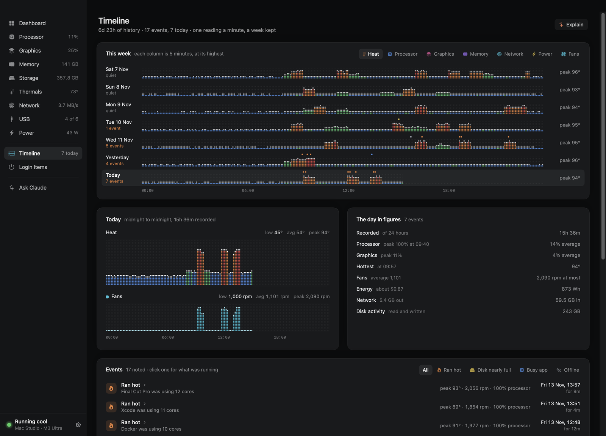
</p>

### Week card

View › Week Card… (or the button on the Timeline) makes a picture of your Mac's week: every hour of the last seven days lit by heat, processor or power, with the hottest moment, the busiest hour, the energy used and what it cost. Save it, copy it or share it. Nothing on it says who you are, and one switch leaves app names off.

<p align="center">
  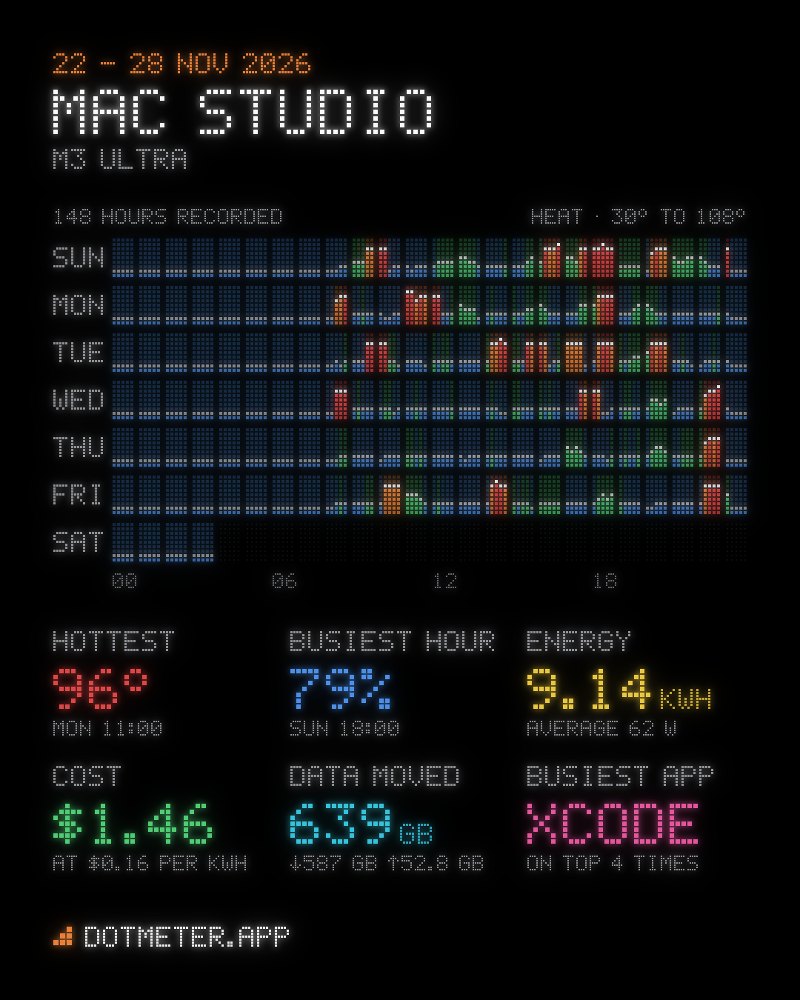
</p>

### Models

The local AI models on this Mac: which are loaded in Ollama, LM Studio, llama.cpp or MLX, how much memory each holds out of the total, where it runs, its context and when it will unload, plus what is on disk and what each runner's processes are using. A Speed button sends one short prompt to a loaded model and shows tokens a second and time to the first token. Nothing is asked unless the Models area is open, and only ports on this Mac are asked.

<p align="center">
  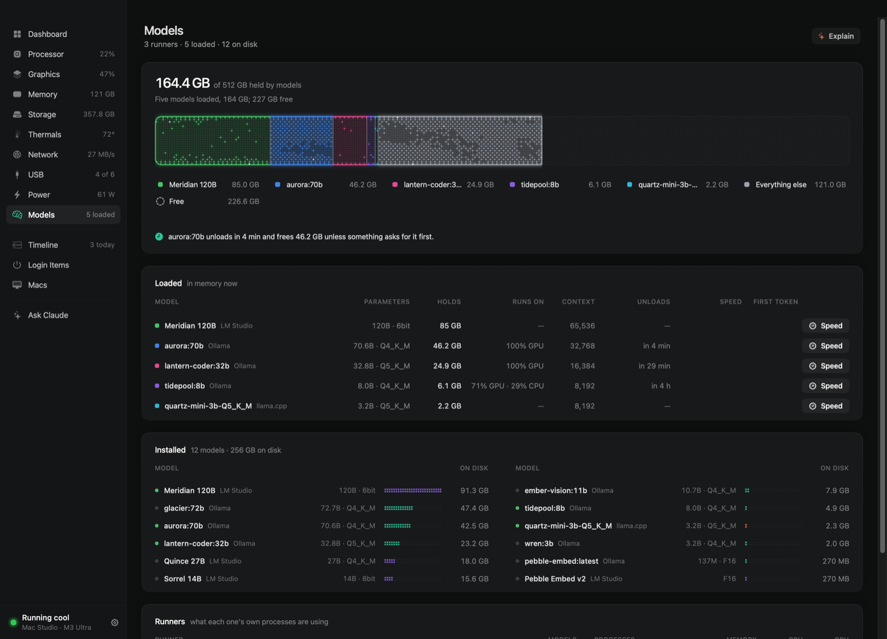
</p>

### Macs

Your other Macs running Dotmeter, side by side with this one: processor, graphics, memory, heat, power and network, the busiest app, disk, battery and uptime on each. Switch it on on both Macs and give them the same code. They find each other on the local network, and nothing can be read without the code. Readings are sent only while another Mac has the page open. It is off until you switch it on.

<p align="center">
  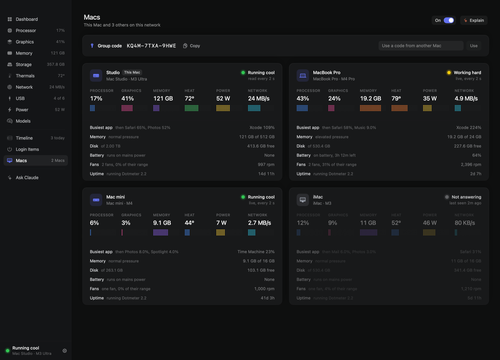
</p>

### Wall and floating meter

Wall (View › Wall, ⇧⌘F) turns a spare display into a wall of live dot-matrix meters: processor, graphics, memory, heat, fans, power, network and disk, each with a large figure and its last five minutes.

<p align="center">
  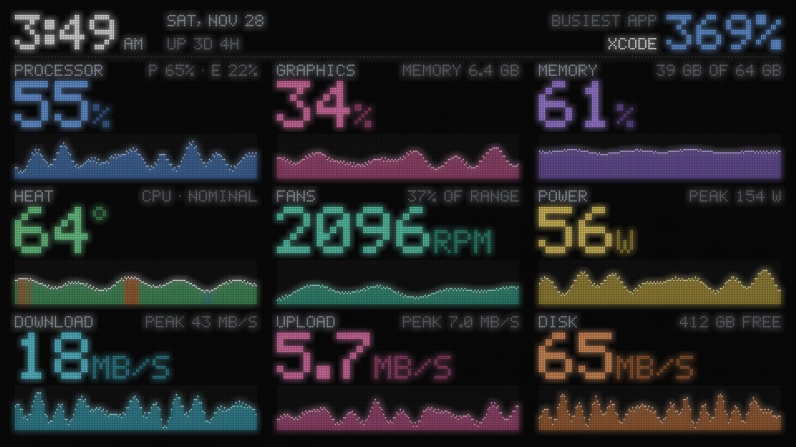
</p>

The floating meter (⇧⌘M) is a small strip with processor, graphics, temperature and watts that stays above every window while a game or a render runs. Drag it anywhere; right-click it to choose figures, opacity or click-through. It cannot show frames per second, because macOS does not let one app read another's.

<p align="center">
  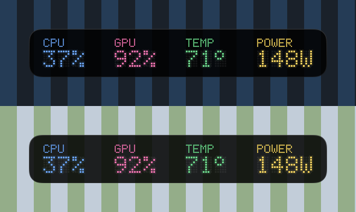
</p>

### Dot colors

Settings › Display lights every dot in one color if you like: Amber, Green or White, besides the full-color look. Red still means something is wrong.

<p align="center">
  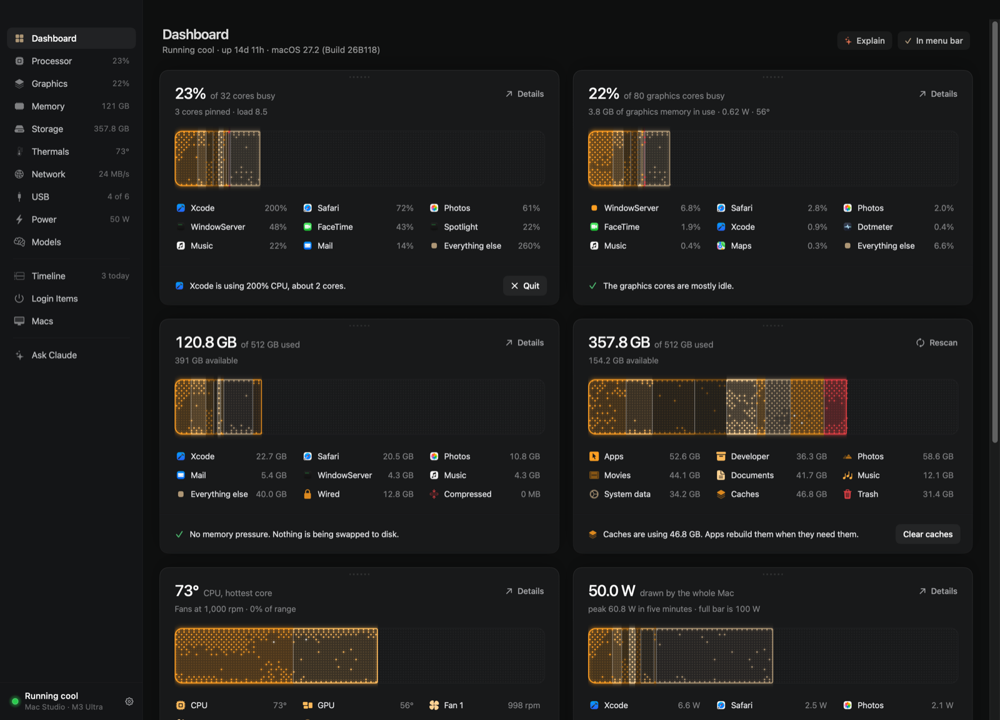
</p>

### Command line and AI apps

Dotmeter also answers from a terminal: `Dotmeter status` prints the whole Mac in a few lines, and `cpu`, `memory`, `network`, `apps`, `timeline` and the rest go deeper, with `--json` for scripts.

```bash
/Applications/Dotmeter.app/Contents/MacOS/Dotmeter status
```

`Dotmeter mcp` serves the same readings to an AI app such as Claude over the Model Context Protocol, so you can ask it why your Mac is slow or what ran hot last night. Settings has the lines to copy. The server only reads, and it never gives out an address or a network's name.

### Ask Claude or GPT

Ask what is going on with your Mac and get an answer based on a snapshot of the readings: what is busy, whether it is normal, and what to do about it. Every area also has an Explain button. You bring your own API key, from Anthropic or OpenAI, and it is stored in the Keychain.

<p align="center">
  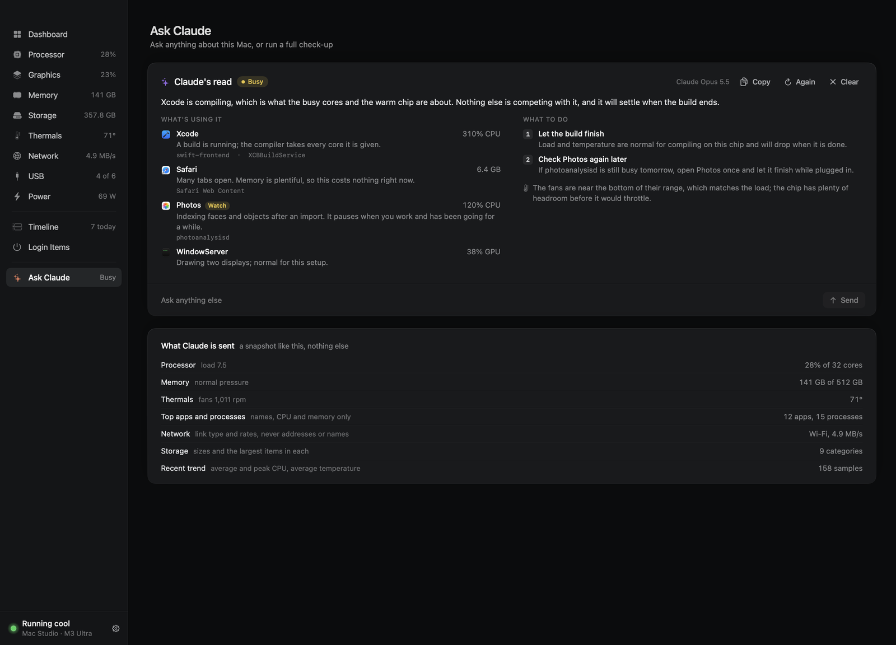
</p>

### Also

- **Login Items**: what starts with your Mac, with a way to remove each.
- **Graphics**: load, memory and per-app share of the graphics cores.
- A window that remembers where you left it, and a Dock icon only while the window is open.

## Requirements

- macOS 14 or later.
- Apple silicon or Intel. It was built and tested on Apple silicon; the Intel build runs under Rosetta in testing and has not been run on an Intel Mac.

## Install

Download the latest `Dotmeter-<version>.dmg` from the [Releases page](https://github.com/ysrdevs/dotmeter/releases/latest), open it and drag Dotmeter onto Applications. The app is signed and notarized by Apple.

After that Dotmeter looks for a new version once a day and tells you when there is one. It installs it when you press Install, and only if the download is signed by the developer and notarized by Apple.

<p align="center">
  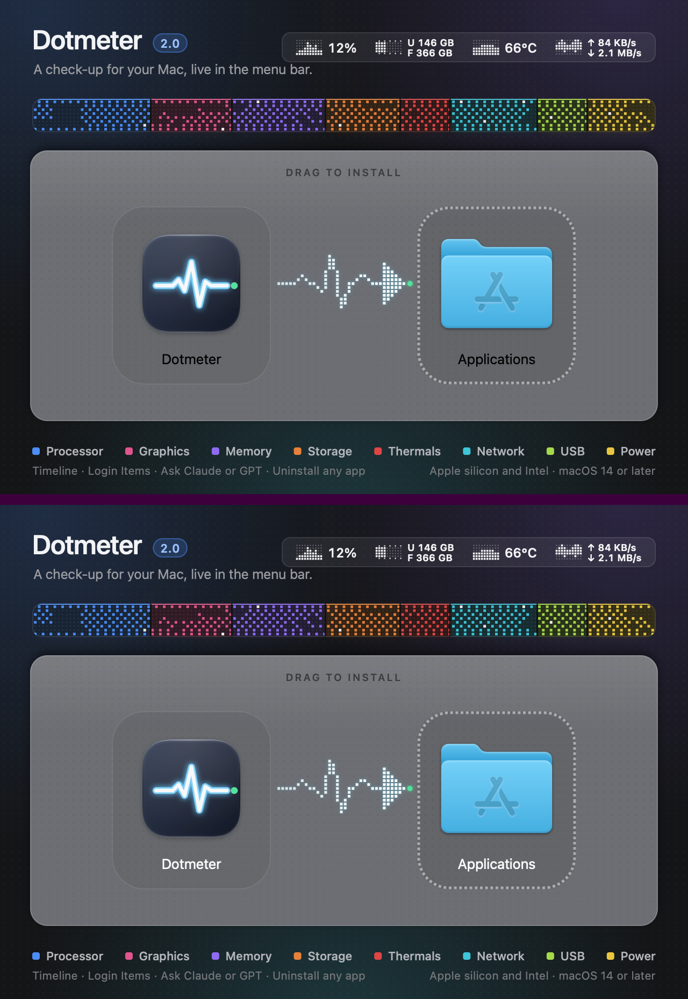
</p>

## Build from source

Requires Xcode 15 or later.

```bash
Scripts/build.sh release --install --run
```

This builds the Swift package, assembles `Dotmeter.app`, signs it with your Apple Development identity if you have one, copies it to `/Applications` and launches it.

To make a notarized disk image for other Macs:

```bash
Scripts/package.sh
```

That needs a Developer ID Application certificate and a `notarytool` keychain profile. The details are in [docs/NOTES.md](docs/NOTES.md).

## Setting up the assistant

Open Settings, choose Claude or GPT under Assistant, and paste your API key. Each provider keeps its own key, so you can switch between them. Without a key everything else works as normal.

## What leaves your Mac

Dotmeter reads your Mac locally. It only uses the network for these, and each can be switched off or simply not used:

- **Assistant requests** go to `api.anthropic.com` or `api.openai.com`, only when you ask.
- **Latency echoes** go to your router and to `1.1.1.1` while the Network area is open.
- **External IP** is asked of `1.1.1.1` when the Network area or panel opens.
- **Speed test** uses Apple's `networkQuality`, only when you press the button.
- **Update check** asks `api.github.com` once a day which version is the newest. A new version is downloaded from GitHub only when you press Install.
- **Macs**, if you switch it on, talks to your other Macs on the local network only, encrypted with the code you give them.
- **Models** asks the model runners on this Mac itself, never another machine.

There are no accounts, analytics or tracking.

## Permissions macOS may ask for

- **Files and folders**, the first time you scan the disk. Only sizes are read, never contents.
- **Full Disk Access** is optional and lets the scan measure Photos and the Trash.
- **Notifications**, if you switch on any alert.
- **Local network**, for the echo to your router, and for finding your other Macs if you switch Macs on.
- **Login Items**, once, to allow the uninstall helper.

## Project layout

```
Sources/Dotmeter         The app: collectors, models, pages, panels and the design kit
Sources/DotmeterShared   What the app and its helper share
Sources/DotmeterHelper   The uninstall helper
Sources/CDotmeter        A small C shim for system calls
Scripts                  Build, package and the install window
Resources                Info.plist, icon, entitlements
docs                     Screenshots and technical notes
```

More detail on how each reading is taken, performance, the uninstaller's rules and the debug switches is in [docs/NOTES.md](docs/NOTES.md).

## License

Dotmeter is open source under the [MIT License](LICENSE).
